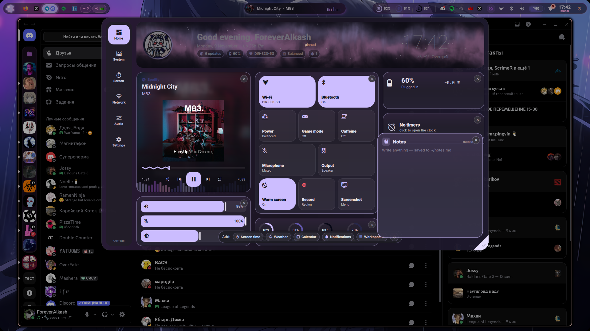
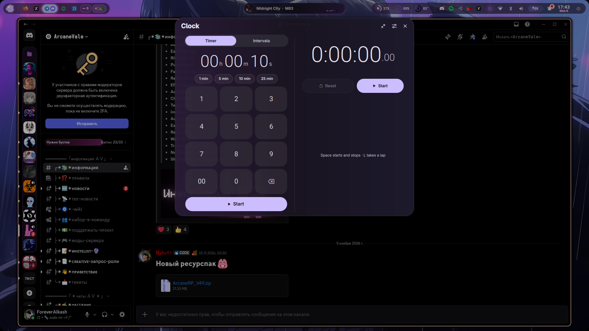

# rice

🇺🇸 [English](#english) · 🇷🇺 [Русский](#русский)

---

## English

My personal Hyprland setup. This is a **fork of [Prism](https://github.com/Jack02134x/prism-shell)** — I take its base (the quickshell shell + wallpaper-driven theming) and bend it my own way.

### Screenshots

|                                                       |                                                    |
| ----------------------------------------------------- | -------------------------------------------------- |
|                |           |
| *Dashboard: player, weather, screen time, toggles*    | *Wallpaper picker — the whole system is tinted by them* |
|                    |                       |
| *The bar over fullscreen apps*                        | *Lock screen + avatar*                             |
|                |                     |
| *Home tab edit mode: drag, ✕ removes, tray adds back* | *Clock panel: timer and stopwatch side by side*    |

### What I built myself

The base is Prism, but inside I added:

- **AI in the launcher** — `q <question>` goes to a local Ollama, works without any cloud
- **Update counter** — pacman updates are visible right in the drawer and on the dashboard
- **Audio output switcher** — headphones/speakers/monitor in a couple of clicks, with jack filtering
- **Notes** — a floating kitty window with a markdown file, on a hotkey
- **Warm screen** — hyprsunset with remembered state

I also **removed** what I don't use: study noise, GLava, the KDE Connect phone integration, the dashboard's Media tab.

A preview of what I tuned recently (screenshots above):

- **The Home tab is built with the mouse** — the corner stripe button toggles edit mode: drag widgets between the three columns, ✕ removes one, the "Add:" tray brings it back (calendar, battery, timers, workspaces, notes, notifications). The layout lives in config.json, empty columns keep their place. The player/sliders/stats have fixed sizes, the rest stretches.
- **The left drawer is customizable the same way** — the same diagonal corner button: drag to reorder, ✕, tray.
- **The clock is a panel, not a window** — clicking the Timers card slides a panel out from under the bar: timer and stopwatch side by side, settings. Timer/alarm rings go through the island's notifications (Stop / +1 min right on the peek), the sound dies on its own after 15 s.
- **The player stretches by height** — the card fills what's left of its column (the cover grows with it); the drawer does the same vertically.

I turned the theme monochrome — one primary colour instead of a rainbow of accents, the launcher and lock screen reworked. Small config bits: a fixed cliphist, Throne and Telegram on their own workspaces. My own configs on top — `hypr/hyprland.lua`, touchpad swipes as back/forward, qt6ct/GTK themes.

I don't keep a line-by-line diff from vanilla — just compare with [upstream](https://github.com/Jack02134x/prism-shell), there aren't that many divergences.

### Layout

```
hypr/        — hyprland.lua (Lua config) + scripts
quickshell/  — the shell itself (a Prism fork) + my edits
matugen/     — templates: wallpaper → kitty / GTK / QT / bar
kitty/ gtk-3.0/ gtk-4.0/ qt6ct/  — app themes
cava/ btop/ fastfetch/ easyeffects/ — small stuff
screenshots/ — screenshots for this README
install.sh   — one-command install
```

### Install

Clean Arch, no DE:

```bash
git clone https://github.com/ForeverAlkash/rice.git ~/rice
cd ~/rice && ./install.sh
```

The script:

1. installs the packages (Hyprland, quickshell, matugen, PipeWire, NM, kitty, hyprsunset, fonts, etc.) in one pacman transaction
2. lays the configs into `~/.config` (backs up existing ones), seeds config.json and the lock screen's pam file
3. pulls the wallpapers from upstream (they're heavy, I don't keep them in the repo)
4. sets up ydotool and the `input` group for swipe gestures

Login: `exec Hyprland` in `~/.zprofile`. Keybind cheat sheet — `SUPER + /`.

### Credits

All the base is [Jack02134x](https://github.com/Jack02134x) and his [Prism](https://github.com/Jack02134x/prism-shell). Thanks for the work done, I just tuned it my way.

---

## Русский

Мой личный сетап Hyprland. Это **форк [Prism](https://github.com/Jack02134x/prism-shell)** — беру оттуда основу (quickshell-шелл + крашение темы от обоев), дальше всё докручено под себя.

### Скрины

|                                                          |                                             |
| -------------------------------------------------------- | ------------------------------------------- |
|                   |    |
| *Дашборд: плеер, погода, скринтайм, тумблеры*            | *Пикер обоев — от них красится вся система* |
|                       |                |
| *Бар поверх приложений*                                  | *Локскрин + аватар*                         |
|                   |              |
| *Edit mode Home-таба: тащи, ✕ — убрать, трей — добавить* | *Часы-панель: таймер и секундомер рядом*    |

### Что тут самодельное

Основа — Prism, но внутрь я добавил:

- **AI в лаунчере** — `q <вопрос>` уходит в локальную Ollama, работает без облака
- **Счётчик обновлений** — pacman-обновления видны прямо в шторке и на дашборде
- **Переключатель аудиовыхода** — наушники/спикеры/монитор в пару кликов, с фильтрацией джеков
- **Заметки** — плавающее окошко kitty с markdown-файлом, по хоткею
- **Тёплый экран** — hyprsunset с запоминанием состояния

А ещё **вырезал** то, чем не пользуюсь:  study noise, GLava, интеграцию с телефоном через KDE Connect, вкладку Media в дашборде.

Предпросмотр того, что докрутил недавно (скрины выше):

- **Home-таб собирается мышкой** — кнопка-полоска в углу включает edit mode: тащишь виджеты между тремя колонками, ✕ убирает, трей «Add:» возвращает (календарь, батарея, таймеры, воркспейсы, заметки, уведомления). Раскладка живёт в config.json, пустые колонки остаются на месте. Фиксированные размеры у плеера/слайдеров/статики, гибкие тянутся.
- **Левая шторка настраивается так же** — та же диагональная кнопка в углу: порядок виджетов перетаскиванием, ✕, трей.
- **Часы — панель вместо окна** — клик по карточке Timers выдвигает панель из-под бара: таймер и секундомер рядом, настройки. Звонок таймера/будильника идёт через уведомления острова (Stop / +1 min прямо на пике), звук сам глохнет через 15 с.
- **Плеер тянется по высоте** — карточка заполняет остаток колонки (обложка растёт вместе с ней), в шторке — аналогично автозаполнение по вертикали.

Тему перевёл в монохром — вместо радуги акцентов один primary-цвет, лаунчер и локскрин переработаны. Мелочи в конфигах: пофикшенный cliphist, Throne и Telegram на своих воркспейсах. Свои конфиги поверх — `hypr/hyprland.lua`, свайпы тачпада как back/forward, qt6ct/GTK-темы.

Подробный построчный diff от ванили я не веду — просто сравни с [upstream](https://github.com/Jack02134x/prism-shell), расхождений не так много.

### Структура

```
hypr/        — hyprland.lua (Lua-конфиг) + скрипты
quickshell/  — сам шелл (форк Prism) + мои правки
matugen/     — шаблоны: обои → kitty / GTK / QT / бар
kitty/ gtk-3.0/ gtk-4.0/ qt6ct/  — темы приложений
cava/ btop/ fastfetch/ easyeffects/ — мелочи
screenshots/ — скрины для этого README
install.sh   — установка одной командой
```

### Установка

Чистый Arch, без DE:

```bash
git clone https://github.com/ForeverAlkash/rice.git ~/rice
cd ~/rice && ./install.sh
```

Скрипт:

1. ставит пакеты (Hyprland, quickshell, matugen, PipeWire, NM, kitty, hyprsunset, шрифты и т.д.) одним pacman-ом
2. раскладывает конфиги в `~/.config` (старые бэкапит), сеет config.json и pam для локскрина
3. докачивает обои из upstream (они тяжёлые, в репо не тяну)
4. настраивает ydotool и группу `input` для жестов

Логин: `exec Hyprland` в `~/.zprofile`. Шпаргалка по клавишам — `SUPER + /`.

### Благодарности

Вся база — [Jack02134x](https://github.com/Jack02134x) и его [Prism](https://github.com/Jack02134x/prism-shell). Спасибо за проделанную работу, я лишь докрутил под себя.
