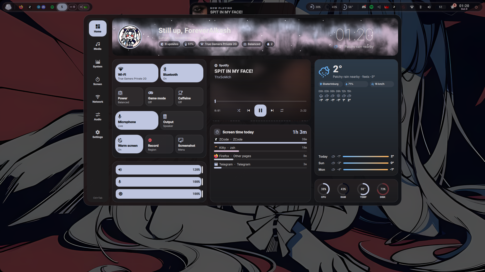
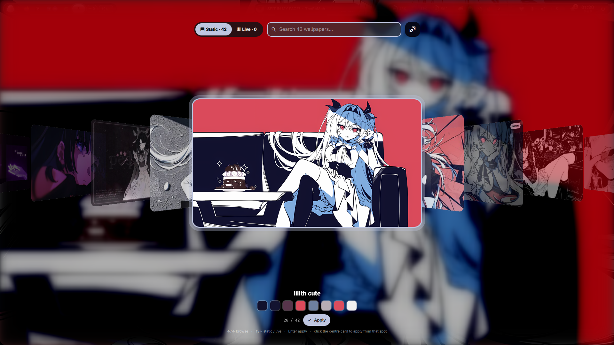
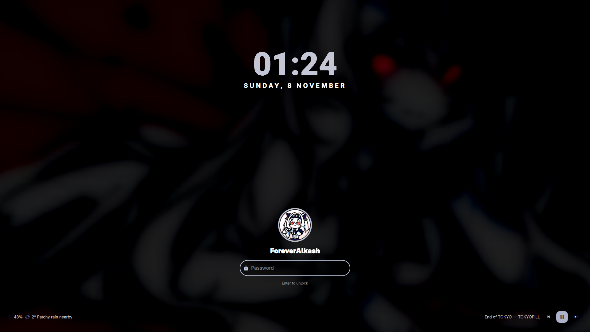
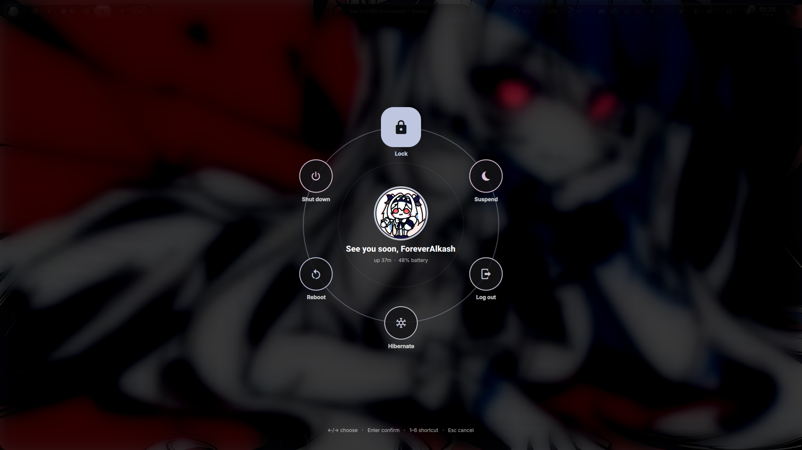
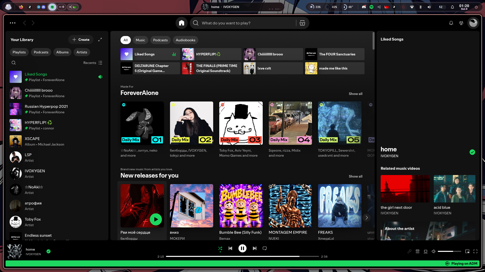

# rice

> [!NOTE]
> Это форк [Prism](https://github.com/Jack02134x/prism-shell) — quickshell-шелла для Hyprland от [Jack02134x](https://github.com/Jack02134x). Вся магия окраски от обоев (matugen) и каркас — его; мои отличия перечислены [ниже](#отличия-от-ванильного-prism).

## Превью

**Dashboard** (`SUPER + D`) — плеер, погода, скринтайм, тумблеры:



**Пикер обоев** — matugen красит kitty/GTK/QT/bar от выбранной картинки:



**Lock** и **exit**:

<p align="center">
  
  
</p>

**Бар** поверх приложений (Spotify):



## Мой взгляд

Ванильный Prism — отличный каркас, но я захотел: убрать не нужное мне (clock-app, study noise, GLava, KDE Connect), добавить местные плюшки (Ollama в лаунчере, счётчик обновлений, переключатель аудиовыхода, скретчпад, тёплый экран) и перевести тему в монохром. Дальше — список по пунктам.

## Отличия от ванильного Prism

**Убрано:**
- floating clock (Chrono) и вся его IPC/таймерная обвязка — часы переделаны на чистый quickshell
- study noise (brown/pink/white через ffplay) и его роль в Pomodoro (Focus) — остались только паузы и DND
- GLava (десктопный визуализатор)
- KDE Connect / Phone: карточка телефона, «Find my phone» и связанные иконки

**Добавлено:**
- **AI в лаунчере** — префикс `q ` шлёт вопрос локальной модели через Ollama; модель/URL/системный промпт настраиваются в `config.json` → `ai`
- **Updates** — счётчик pacman-обновлений: бейдж в шторке управления, чип в дашборде, клик = refresh
- **Audio Output switcher** — переключение наушники/спикеры/монитор с фильтрацией джеков (`Audio.cycleSink`)
- **Screenshot menu** (`ScreenshotMenu.qml`) — панель выбора вместо мгновенного снимка
- **Notes** — скретчпад: плавающий kitty с markdown-файлом в state-директории
- **Warm screen** — тёплый экран через hyprsunset, состояние сохраняется между рестартами шелла

**Изменено:**
- монохромная тема: разноцветные `accent(N)` в дашборде/настройках заменены на единый `primary`
- лаунчер: hover двигает выделение только после реального движения мыши (`mouseArmed`), новый скоринг поиска (`bestScore`), убраны цифровые шорткаты 1–5
- lock screen: компактнее (шрифт 105 вместо 210, свои отступы маски), аватар — `MyAvatar/lilith.jpeg`
- `prism.lua`: автостарт Bluetooth-агента (`bt-agent`, чтобы наушники не отваливались на passkey), исправлен контроль cliphist-вечеров (`pgrep -ax` вместо `pgrep -f`), Throne на `special:magic`, Telegram на workspace 3

**Свои конфиги поверх:** `hypr/hyprland.lua`, `libinput-gestures.conf` (свайпы → mouse4/5), qt6ct/kdeglobals, dolphinrc, mimeapps.list.

## Что внутри

- `hypr/` — hyprland.lua (Prism starter, Lua-конфиг) + скрипты
- `quickshell/` — Prism shell целиком (bar, launcher, dashboard, lock) + мои правки
- `matugen/`, `kitty/`, `gtk-3.0/`, `gtk-4.0/`, `qt6ct/` — темизация от обоев (matugen → kitty/GTK/QT)
- `cava/`, `btop/`, `fastfetch/`, `easyeffects/` — мелкие конфиги
- `libinput-gestures.conf` — свайпы тачпада → back/forward (mouse4/5)

## Установка

На чистом Arch (без DE):

```bash
git clone https://github.com/ForeverAlkash/rice.git ~/rice && cd ~/rice && ./install.sh
```

Клонировать можно куда угодно — скрипт сам раскладывает конфиги в `~/.config`.

Скрипт:
1. ставит все пакеты одним pacman-ом (Hyprland, quickshell, matugen, PipeWire, NetworkManager, kitty, thunar, шрифты, иконки, easyeffects, btop, fastfetch, mpv, libinput-gestures, ydotool…);
2. копирует конфиги в `~/.config` — существующие файлы бэкапит как `<имя>.bak-<дата>`;
3. докачивает обои (~155 МБ) из upstream prism-shell, если их нет;
4. добавляет юзера в группу `input` и включает демон ydotool (для жестов; нужна перезагрузка/перезаход в сессию).

Логин: в `~/.zprofile` строка `exec Hyprland` (Hyprland стартует с tty1). Показ клавиш райса — `SUPER + /`.
